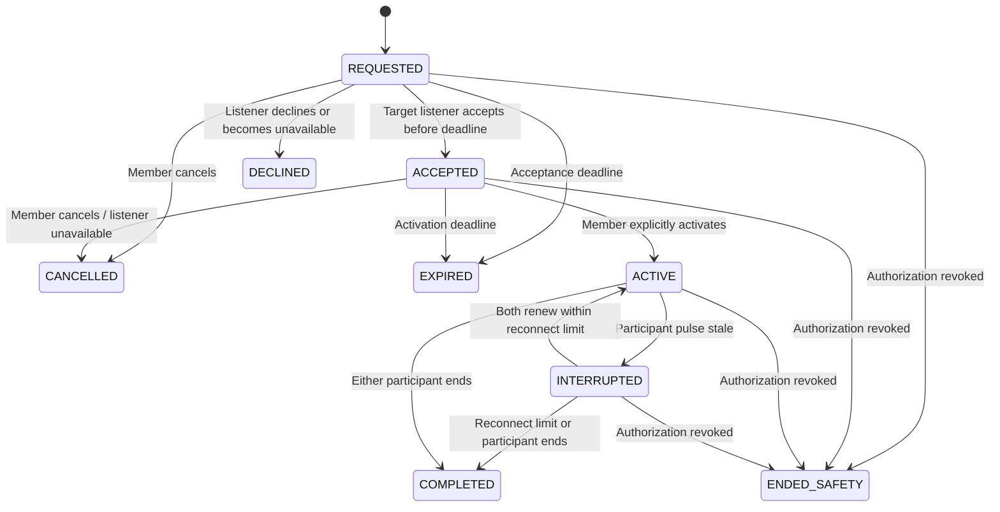

# Actual live support state machine

Terminal rows never reopen. No conversation exists in REQUESTED/ACCEPTED. Conversation creation belongs to explicit activation. State GET is an authorized polling projection, not implied acceptance. Idempotent retries of accept/activate/cancel/end return the recorded outcome without creating another conversation. Deadline comparisons are strict: at the exact deadline acceptance loses. Presence and interrupted deadlines are snapshot configuration values.
