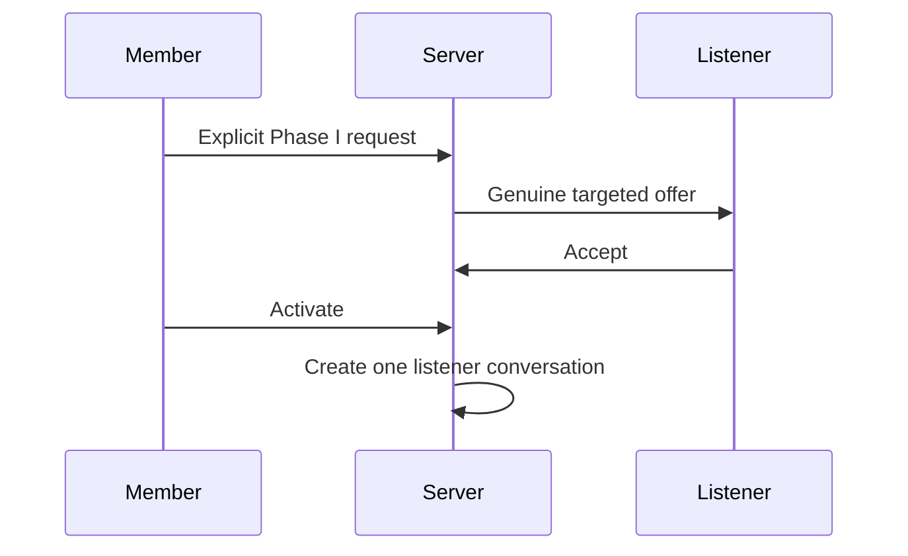
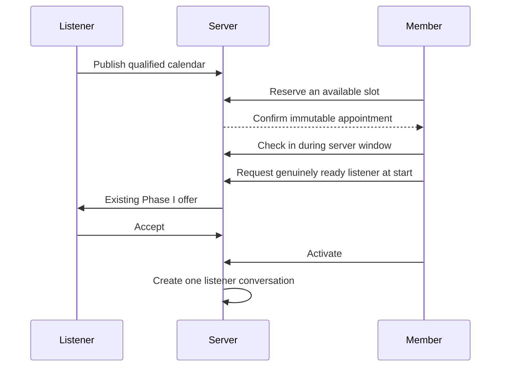

# Live handoff sequences
## Immediate

## Scheduled

Queue sequence is pending the N2 milestone. The existing Phase I acceptance, activation, presence, interruption and safety rules remain authoritative.
