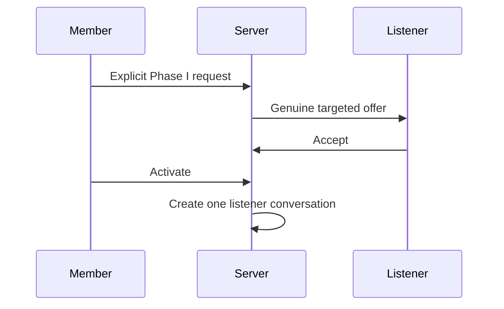
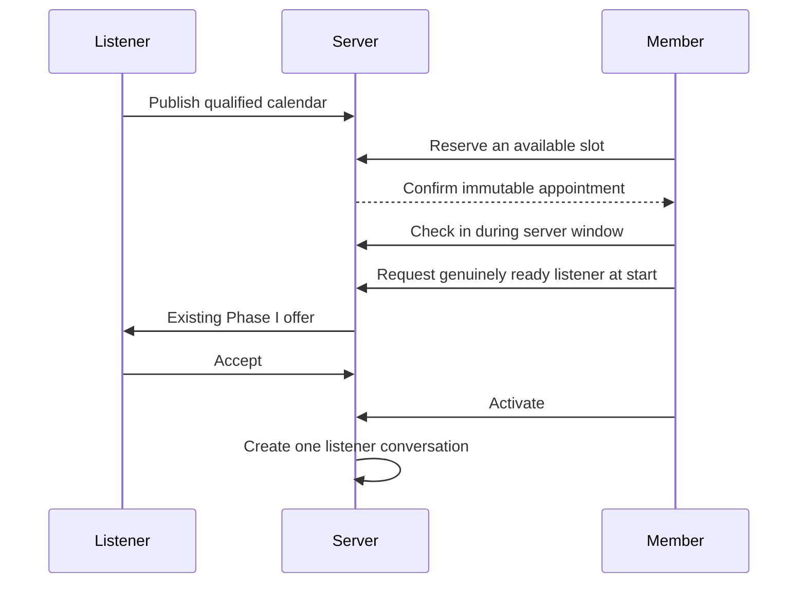
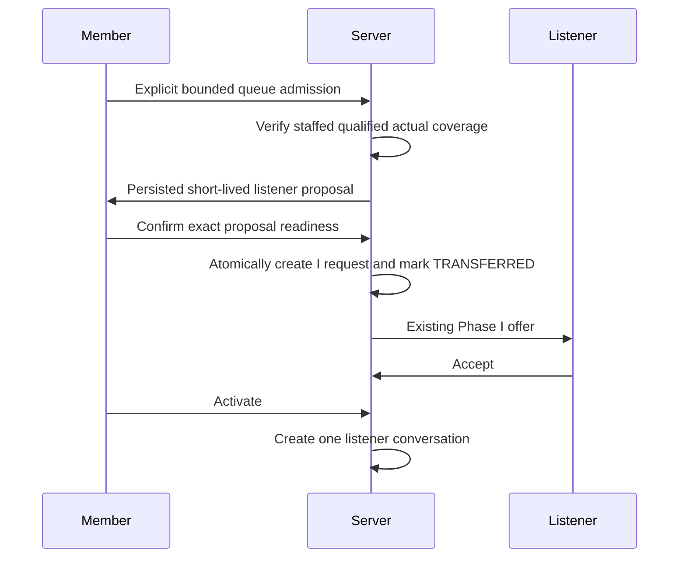

# Live handoff sequences
## Immediate

## Scheduled

## Queue

The transfer commit is the independence point: later parent expiry cannot invalidate this I request. The existing Phase I acceptance, activation, presence, interruption and safety rules remain authoritative.
